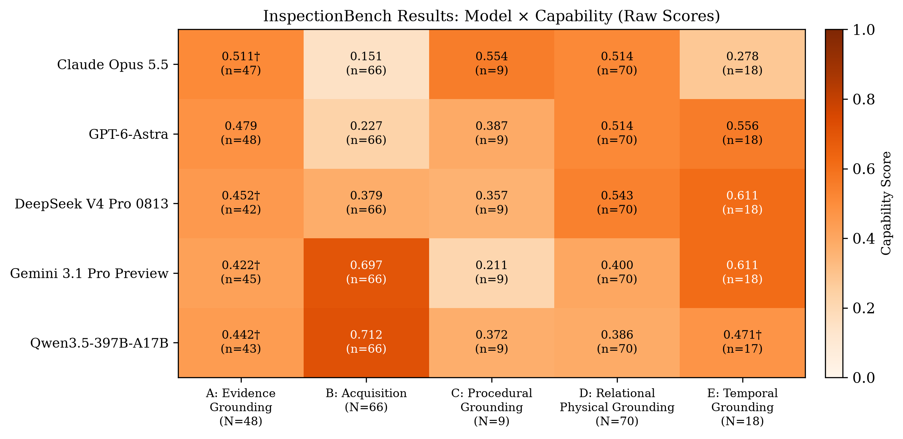
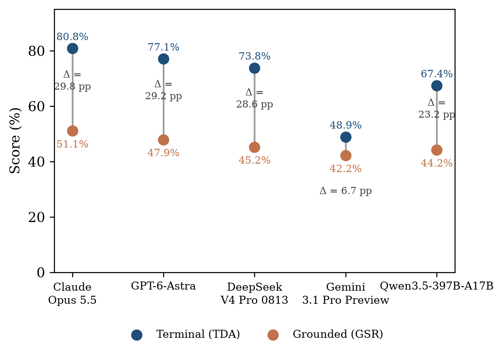
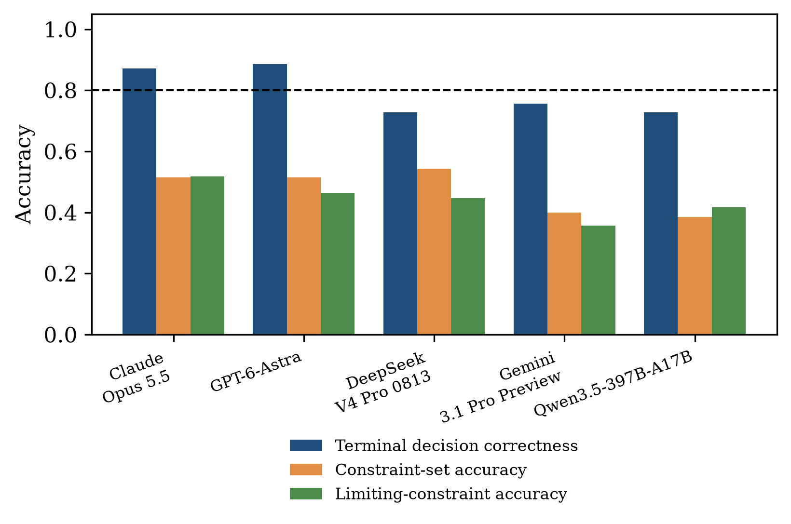
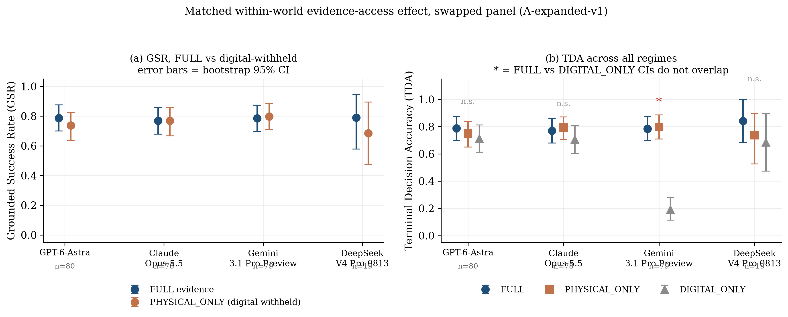

# InspectionBench

**Evidence-Grounded Evaluation of Agentic Industrial Inspection**

*Anonymous repository for double-blind review.*

InspectionBench is an execution-grounded benchmark for agentic physical AI in industrial
inspection. An agent receives an alert and asset context, acquires visual, operational,
and telemetry evidence through tool calls, and turns the returned observations into an
operational decision — `COMMIT`, `ESCALATE`, or `ABORT` — before issuing the matching
enterprise action. Unlike benchmarks that supply evidence in the prompt, InspectionBench
scores whether the agent actually acquired the evidence it relied on: a plausible-looking
terminal decision is only credited if the delivered observations satisfy the grounding
contract behind it.

## Why this benchmark

Industrial monitoring produces alerts, not decisions. An autonomous inspection agent must
decide what to inspect, which evidence channel to use, when it has acquired enough, whether
the required procedure was actually completed, whether the proposed physical action is
admissible, and whether evidence acquired earlier is still valid by the time it commits.
InspectionBench operationalizes each of these questions as an independent, scored
capability, rather than a single leaderboard number.

| Capability | Question it answers |
|---|---|
| **A** — Evidence grounding | Did the terminal decision actually follow from evidence the agent received? |
| **B** — Evidence acquisition | Did the agent recognize what evidence it needed and select the right acquisition? |
| **C** — Procedural execution | Did the inspection actually happen, or just produce a plausible tool trace? |
| **D** — Relational physical grounding | Does the agent understand the physical constraint governing its proposed action? |
| **E** — Temporal grounding | Is the evidence still valid when the agent finally commits? |

## Dataset at a glance

- **4,120** canonical episodes generated from **1,552** grounded worlds and **21**
  scenario templates across six industrial asset types; **4,071** remain eligible after
  removing 45 observationally identical duplicates and 4 episodes whose gold is
  unreachable (`results/expanded_evaluation_v1/eligibility_exclusions.csv`).
- **116** facility-collected images, **1,296** procedurally rendered perception scenes,
  and **24,601** replayed operational records (IoT, acoustic, thermal, access-geometry,
  visual-defect, work-order-history), each carrying an explicit evidence-provenance class.
- A **world-to-scenario compiler** that holds a world's physical state and gold decision
  fixed while varying only what the agent can observe or access (evidence visibility,
  modality/tool access, temporal validity), certified with a world-state hash so that a
  score difference inside a matched set is attributable only to what the agent could
  reach — never to a silently different world.
- **25** agent-visible tool names (21 FastMCP tools plus 4 environment adapters) spanning two backends (a Spot-SDK-shaped robot interface and
  an enterprise asset-management interface), covering seven evidence modalities.

## Repository layout

```
InspectionBench/
├── README.md
├── src/                          # core compiler and scoring modules
│   ├── scenario_gen.py           # asset registry, world construction (A-family)
│   ├── scenario_contract.py      # evidence-provenance classes, scenario binding
│   ├── cd_generator.py           # parameterized C/D template generator + scorer
│   ├── sequence_executor.py      # multi-episode sequence generator (E-family)
│   ├── classc_fixtures.py        # hand-authored procedural fixture set (C-family)
│   ├── couchdb_executor.py       # server-backed tool-execution environment
│   ├── tool_executor.py          # tool-call dispatch and result contract
│   ├── execution_trace.py        # tamper-evident, hash-chained execution trace
│   ├── l3_scoring.py             # terminal-action normalization/comparison
│   ├── l3_grounded_scoring.py    # grounded success rate (GSR) scoring
│   └── ordering.py               # procedural ordering-satisfaction check
├── data/examples/                # one complete compiled episode per capability
│   ├── example_A_evidence_grounding.json
│   ├── example_B_evidence_acquisition.json
│   ├── example_C_procedural_execution.json
│   ├── example_D_physical_grounding.json
│   └── example_E_temporal_grounding.json
├── figures/                      # capability-score and grounding-gap figures
├── interface/                    # what the agent sees and returns (see interface/INTERFACE.md)
│   ├── INTERFACE.md              # harness, tool discovery, payloads, call-failure accounting
│   ├── prompts/                  # verbatim system prompts (SHA-256 checked against the runs)
│   ├── example_episode/          # one complete persisted interaction, verbatim
│   ├── tool_schemas/             # full JSON schemas of the 7 FastMCP servers (67 tools)
│   ├── agent_visible_tool_lists_by_regime.csv
│   ├── agent_visible_tools_to_servers.csv
│   ├── call_lifecycle_by_panel_model.csv, per_tool_outcomes.csv
│   ├── figures/                  # harness architecture and episode workflow
│   └── examples/                 # connecting an MCP client (illustration only)
├── reproducibility/              # REPRODUCE.md, scripts and the tables of Appendix J
└── results/                      # anonymised run records of the full re-run (see below)
```

## Results



Terminal-decision accuracy (TDA) substantially overstates evidence-grounded success (GSR)
for every model evaluated — a policy that always escalates reaches high terminal accuracy
on this pool while acquiring no evidence at all, scoring zero on GSR.



The same pattern reappears in physical grounding: a model can reach the correct
terminal decision while still failing to recover *which* physical constraint made that
decision correct.



Matching a world across evidence-access regimes (`FULL` / `PHYSICAL_ONLY` / `DIGITAL_ONLY`)
while holding the underlying fault state fixed exposes a further failure: several models'
terminal accuracy barely drops under `DIGITAL_ONLY`, despite having no physical evidence
to ground a decision in.



## Agent interface

The scored runs use a fixed two-call harness. In STEP 1 the agent requests tools **by name**
from the list offered in its regime (25 / 23 / 22 names). The executor binds each call to the
episode's asset and runs the first eight. In STEP 2 the agent receives every result, failed
ones included, and returns its verdict. `interface/INTERFACE.md` documents the full interaction:
- the verbatim prompts;
- a complete persisted episode (`interface/example_episode/TRANSCRIPT.md`);
- every field each tool returns (`read_gauge` returns a numeric reading with confidence and an
  occlusion flag, but no image);
- the full FastMCP tool schemas, which the scored runs did not show to the models;
- call-level accounting over 14,440 traced episodes: 0 argument or format errors, and 0 of
  26,612 gold-determining calls failed.

## Evaluation runs and reproducibility

`results/` holds the full re-run: all 4,071 eligible episodes for each of five models
(20,355 episodes, 48,411 metered model calls). For every episode it contains:
- the text sent to the model in each turn (images replaced by their SHA-256);
- the parsed replies;
- every tool result;
- the hash-chained execution trace and the scores.

It also includes the per-call token ledgers, worker timing logs, the frozen protocol file
(hashes of every executed file), the eligible-episode lists with each exclusion and its
reason, a pre-registered repeat run (stability control) and the citation-enabled V2 panel.

`reproducibility/REPRODUCE.md` shows how to recompute the tables from these records:
- episode accounting from constructed to scored;
- tokens, time and cost;
- full-pool capability scores;
- repeat stability.

No API key is needed. Local paths in the records were replaced by `<REPO>`, `<HOME>` and
`<DATA_DRIVE>`, as logged per file in `results/RELEASE_MANIFEST.json`.

## Scoring contract

Every success predicate is a pure function of the agent's response and its execution
trace — none are LLM-judged. The primary predicates are conjunctive: a decision is
credited as grounded only if the required observation was actually delivered (non-null
observation identifier, successful tool execution), its provenance hash-chain verifies,
the agent's citation (if any) matches a delivered observation of the required modality,
and no forbidden action was executed. Full per-capability predicate definitions (TDA,
GSR, ADA, ASA, UHA, procedural coverage, ordering satisfaction, CSA, LCA, TVR) are
reproduced in `src/` docstrings and match the released scoring code exactly. The only
illustrative file is `interface/examples/assetopsbench_runner_connection.py`, which produced
no reported score.

## Example episode

`data/examples/example_D_physical_grounding.json` is a compiled physical-admissibility
episode: an agent must recognize that an open corrective work order on the target asset
means the correct action is `ESCALATE`, not `DISPATCH`, and that doing so requires calling
`list_waypoints`, `get_battery`, `navigate_to`, and `get_work_order` — in that order —
before deciding. The full execution trace is tamper-evident: every event stores a hash of
its predecessor, so a score difference can always be traced back to what the agent actually
did, not to an ambiguous record.

## Status

This repository accompanies a paper currently under double-blind review. It is provided
for reviewer inspection of the benchmark's construction, scoring contract, agent interface,
example data and the full evaluation records (`results/`). The complete evidence substrate
(CouchDB data volume, rendered scenes and tool servers) needed to re-run models from scratch
will be released on publication.

## License

Released for review purposes. A permissive open-source license will be finalized on
publication.
